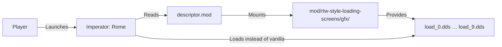
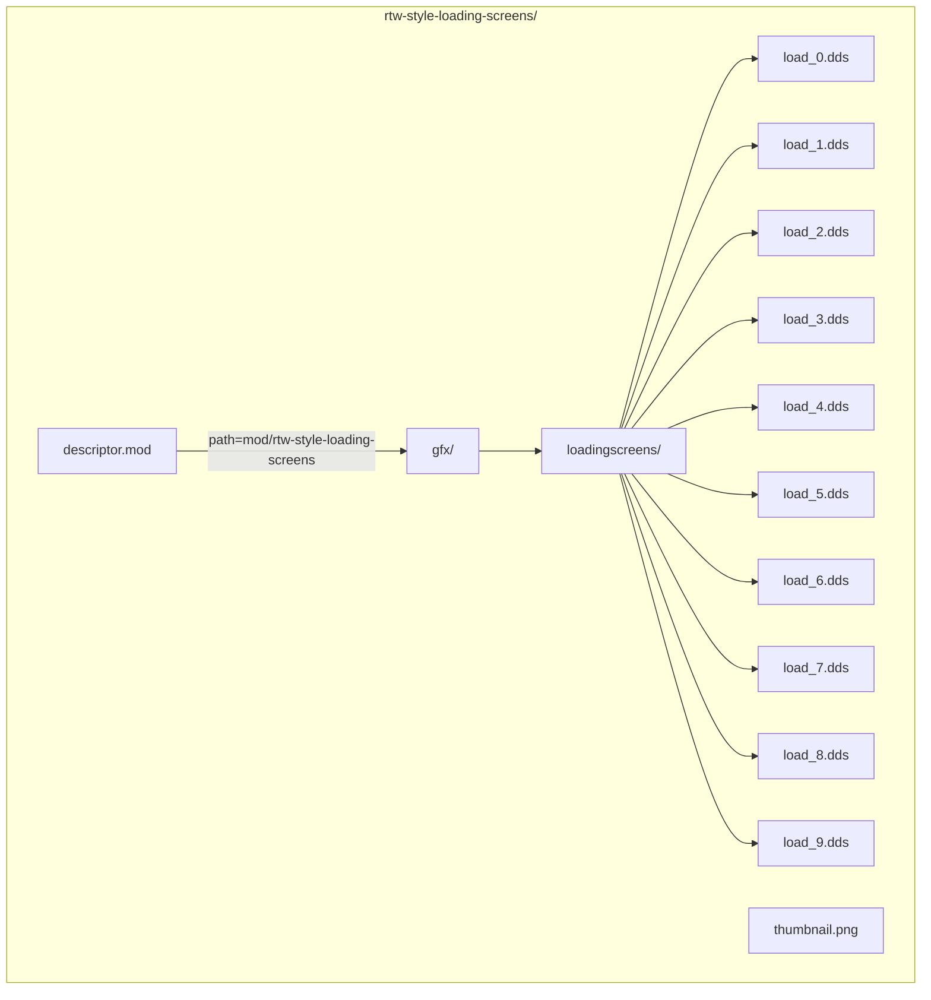
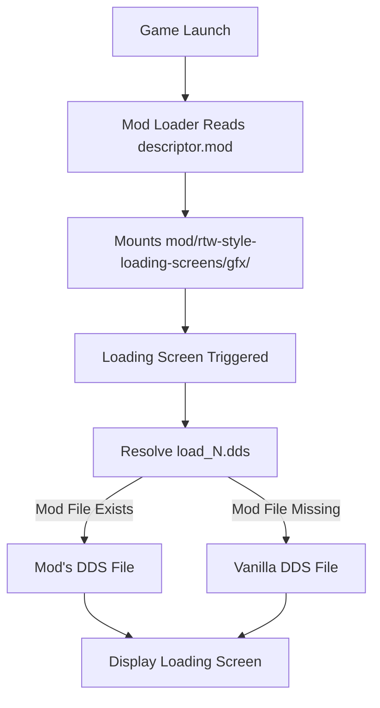
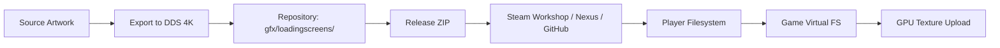
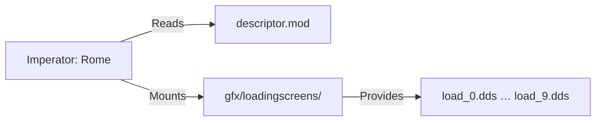

# Imperator: Rome - RTW-Style Loading Screens Architecture

This document describes the current architecture of the Imperator: Rome - RTW-Style Loading Screens mod. It covers the static asset structure, mod loading integration, distribution channels, and compatibility constraints.

## 📑 Table of Contents

- [Purpose](#purpose)
- [System Context](#system-context)
- [Architectural Style](#architectural-style)
- [Runtime Flow](#runtime-flow)
- [Components](#components)
- [Architectural Areas](#architectural-areas)
- [Data Architecture](#data-architecture)
- [Interfaces and Integrations](#interfaces-and-integrations)
- [Dependency Direction and Rules](#dependency-direction-and-rules)
- [Deployment and Operations](#deployment-and-operations)
- [Compatibility Contracts](#compatibility-contracts)
- [Testing and Verification](#testing-and-verification)
- [Design Constraints](#design-constraints)
- [Extension Points](#extension-points)
- [Source Map](#source-map)
- [Related Documentation](#related-documentation)

## 🎯 Purpose

This document records the architecture of a content-only mod for Imperator: Rome that replaces the game's vanilla loading screens with artwork matching the art style of Rome: Total War (2004). The audience is maintainers and contributors who need to understand the asset structure, mod loading contract, distribution pipeline, and compatibility boundaries. The mod contains no executable code, runtime, or network communication.

## 🌐 System Context

The mod operates entirely within the Imperator: Rome game process. The game's mod loader reads the mod descriptor, mounts the mod's `gfx/` directory, and substitutes the mod's DDS files for the vanilla loading screens when the game starts a loading sequence.



The principal external boundaries are:
- **Imperator: Rome Mod Loader:** Reads `descriptor.mod`, mounts the mod path, and substitutes `gfx/loadingscreens/load_*.dds` files at runtime. Owned by Paradox Interactive.
- **Steam Workshop / Nexus Mods / GitHub Releases:** Distribution channels that deliver the packaged mod to players. Owned by Valve, Nexus Mods, and GitHub respectively.
- **Player's Local Filesystem:** Stores the installed mod directory and game installation. Controlled by the player.

## 🏗️ Architectural Style

**Static Asset Replacement / Content Mod**

The repository implements a pure content mod: a fixed set of DDS image files that override the game's built-in loading screens via the game's native mod loading mechanism. There is no code, scripting, configuration, or runtime logic. The architectural consequences are:
- Zero runtime dependencies beyond the base game.
- No build, compilation, or packaging step beyond zipping the mod directory for distribution.
- Compatibility is governed entirely by the game's mod API (file naming, DDS format, `supported_version` in `descriptor.mod`).
- Changes are limited to replacing or adding DDS files in `gfx/loadingscreens/`.



The principal architecture boundaries are:
- **Mod Descriptor (`descriptor.mod`):** Declares mod metadata, supported game version, and mount path. Permitted dependency: Imperator: Rome 2.0.*.
- **Asset Directory (`gfx/loadingscreens/`):** Contains exactly ten DDS files named `load_0.dds` through `load_9.dds`. Permitted dependency: game expects these exact filenames and DDS format.

## 🔄 Runtime Flow



The principal runtime sequence is:
1. Player launches Imperator: Rome with the mod enabled.
2. Game mod loader reads `descriptor.mod`, validates `supported_version`, and mounts `mod/rtw-style-loading-screens/gfx/` into the virtual filesystem.
3. When a loading screen is triggered, the game requests `gfx/loadingscreens/load_N.dds` (where N is 0–9).
4. The virtual filesystem returns the mod's DDS file because the mod path takes precedence.
5. The game renders the mod's loading screen image.

## 🧩 Components

| Component | Responsibility | Principal Dependencies | Lifetime or Ownership |
|-----------|----------------|------------------------|-----------------------|
| `descriptor.mod` | Declares mod identity, version, supported game version, and mount path | Imperator: Rome mod loader (Paradox) | Static file; updated per release |
| `gfx/loadingscreens/load_0.dds` … `load_9.dds` | Replacement loading screen images in DDS format | Imperator: Rome rendering pipeline (expects DDS, specific dimensions) | Static assets; updated per release |
| `thumbnail.png` | Mod thumbnail shown in launcher and Workshop | Imperator: Rome launcher, Steam Workshop | Static asset; updated per release |

## 🗂️ Architectural Areas

### Mod Root (`rtw-style-loading-screens/`)

Paths:
- `rtw-style-loading-screens/descriptor.mod`
- `rtw-style-loading-screens/gfx/`
- `rtw-style-loading-screens/thumbnail.png`

Responsibilities:
- Provide the complete mod package as expected by the game and distribution channels.

Boundary rules:
- `descriptor.mod` must remain at the root.
- `gfx/` directory structure must mirror the game's expected virtual filesystem path (`gfx/loadingscreens/`).
- No additional directories or files are required.

### Loading Screen Assets (`rtw-style-loading-screens/gfx/loadingscreens/`)

Paths:
- `rtw-style-loading-screens/gfx/loadingscreens/load_0.dds` through `load_9.dds`

Responsibilities:
- Supply exactly ten loading screen images matching the vanilla count and naming convention.

Boundary rules:
- Filenames must be exactly `load_0.dds` … `load_9.dds`.
- Format must be DDS (DirectDraw Surface) compatible with Imperator: Rome.
- Resolution should be 4K (3840×2160) per project specification.
- Art style must match Rome: Total War (2004) aesthetic.

## 💾 Data Architecture

The mod owns no persistent state, databases, or caches. The only data artefacts are the ten DDS image files and the thumbnail PNG. These are static assets with the following characteristics:



| Data or Store | Owner | Representation and Storage | Lifecycle or Consistency |
|---------------|-------|----------------------------|--------------------------|
| `load_0.dds` … `load_9.dds` | Mod maintainers | DDS (DirectDraw Surface), 4K resolution, BC3/DXT5 compression typical | Created at release; immutable per version; replaced entirely on update |
| `thumbnail.png` | Mod maintainers | PNG, 1280×720 typical | Created at release; immutable per version; replaced entirely on update |
| `descriptor.mod` | Mod maintainers | Plain text, Clausewitz script format | Updated per release; version and `supported_version` must match |

## 🔌 Interfaces and Integrations

| Interface or Integration | Direction | Contract | Owner | Failure Semantics |
|--------------------------|-----------|----------|-------|-------------------|
| Imperator: Rome Mod Loader | Inbound (game reads mod) | `descriptor.mod` format; `supported_version` semantic versioning; mount path `mod/rtw-style-loading-screens` | Paradox Interactive | Mod disabled or ignored if `supported_version` mismatch or descriptor malformed |
| Imperator: Rome Virtual Filesystem | Inbound (game reads assets) | `gfx/loadingscreens/load_0.dds` … `load_9.dds` present and valid DDS | Paradox Interactive | Falls back to vanilla loading screen if file missing or corrupt |
| Steam Workshop | Outbound (publish) | ZIP archive with mod directory at root; `changenote` in BBCode | Valve / Maintainers | Publication fails; manual intervention required |
| Nexus Mods | Outbound (publish) | ZIP archive with mod directory at root; metadata via Nexus UI | Nexus Mods / Maintainers | Publication fails; manual intervention required |
| GitHub Releases | Outbound (publish) | ZIP archive attached to Git tag `v*.*.*` | GitHub / Maintainers | Release draft remains unpublished |

## 🧭 Dependency Direction and Rules

The mod has no internal code dependencies. The only dependency direction is external: the game mod loader reads the mod descriptor and assets. The mod must conform to the game's mod API contract.



The principal dependency rules are:
- The mod must not depend on any external runtime, library, or service.
- The mod must conform to the Imperator: Rome mod descriptor format and `supported_version` contract.
- The mod must provide exactly the filenames and DDS format expected by the game's virtual filesystem.
- Distribution channels (Steam Workshop, Nexus Mods, GitHub Releases) are independent publishing targets; the mod content does not depend on any specific channel.

## 🚀 Deployment and Operations

| Concern | Current Design | Architectural Consequence |
|---------|----------------|---------------------------|
| Process topology | No process; static assets loaded by game | Zero operational overhead; no service to monitor |
| Deployment unit | ZIP archive containing `rtw-style-loading-screens/` directory | Single artefact for all channels |
| Persistent state | None | No migration, backup, or recovery needed |
| Filesystem requirements | Player must extract ZIP into game mod directory (or subscribe via Workshop) | Installation is manual or Workshop-managed |
| Scaling assumptions | Single-player client-side only | No horizontal scaling concerns |
| Startup/shutdown | Game handles mod mount/unmount | No custom startup or shutdown logic |
| Operator-visible outputs | Loading screens displayed during game load | Visual verification only |

## 🛡️ Compatibility Contracts

| Contract | Owner | Invariant | Verification | Change Policy |
|----------|-------|-----------|--------------|---------------|
| `descriptor.mod` `supported_version` | Maintainers | Must match target Imperator: Rome version (currently `2.0.*`) | Manual: launch game with mod enabled; check launcher shows mod as compatible | Update `supported_version` when game major version changes; test before release |
| Loading screen filenames (`load_0.dds` … `load_9.dds`) | Maintainers | Exact names and count (10 files) | Manual: verify files exist in `gfx/loadingscreens/` | Do not rename or change count without game mod API change |
| DDS format and resolution | Maintainers | Valid DDS readable by Imperator: Rome; 4K resolution | Manual: load each loading screen in-game; verify no visual artefacts | Re-export if game rendering pipeline changes |
| Steam Workshop item ID (`3513150774`) | Maintainers | Stable across releases | Automated: GitHub Actions workflow publishes to same item ID | Never change; new item ID would break existing subscriptions |
| Nexus Mods ID (`25` for Imperator: Rome) | Maintainers | Stable across releases | Manual: verify Nexus Mods page updates correctly | Never change |

## ✅ Testing and Verification

No automated test suite exists. Verification is manual and visual:

1. Install the mod (via Workshop, Nexus, or manual ZIP extraction).
2. Launch Imperator: Rome with the mod enabled.
3. Start a new game or load a save to trigger loading screens.
4. Verify all ten loading screens display the RTW-style artwork correctly (no missing textures, no vanilla fallbacks, correct aspect ratio).
5. Verify mod appears in launcher with correct name, version, and thumbnail.

Execute the principal manual verification with:

```bash
# No automated command; manual in-game verification required
```

## ⚠️ Design Constraints

- **Vanilla Asset Parity:** The mod must provide exactly ten loading screens (`load_0.dds` … `load_9.dds`) because the game selects from this fixed set. Adding or removing files has no effect unless the game is updated.
- **DDS Format Lock-in:** The game only reads DDS files for loading screens. Other formats (PNG, JPG) are ignored.
- **Game Version Coupling:** `descriptor.mod` declares `supported_version="2.0.*"`. A game major version update (e.g., 3.0) requires updating this field and re-testing.
- **No Code Extension Points:** The mod cannot add new loading screens, randomise selection, or implement conditional logic. It is purely a 1:1 asset replacement.
- **Distribution Channel Immutability:** Steam Workshop item ID and Nexus Mods ID are fixed at creation. Migrating to new IDs would orphan existing subscribers.

## 🔧 Extension Points

No intentional extension points exist. The mod is a closed asset set. Future extensions would require:
1. Game mod API changes (e.g., support for weighted random loading screens).
2. New asset creation following the same DDS/naming conventions.
3. Updated `descriptor.mod` with new `supported_version`.

## 🗺️ Source Map

| Area | Path |
|------|------|
| Mod Descriptor | `rtw-style-loading-screens/descriptor.mod` |
| Loading Screen Assets | `rtw-style-loading-screens/gfx/loadingscreens/` |
| Thumbnail | `rtw-style-loading-screens/thumbnail.png` |
| Release Packaging (GitHub Actions) | `.github/workflows/steam-workshop.yml` |
| Funding Configuration | `.github/FUNDING.yml` |
| Documentation | `README.md`, `CONTRIBUTING.md`, `CODE_OF_CONDUCT.md`, `PRIVACY.md`, `SECURITY.md`, `LICENSE` |

## 📚 Related Documentation

- [README.md](./README.md) — Project overview, installation, and usage.
- [CONTRIBUTING.md](./CONTRIBUTING.md) — Contribution guidelines and development setup.
- [CODE_OF_CONDUCT.md](./CODE_OF_CONDUCT.md) — Community conduct standards.
- [PRIVACY.md](./PRIVACY.md) — Data handling description (no personal data processed).
- [SECURITY.md](./SECURITY.md) — Vulnerability reporting and disclosure policy.
- [LICENSE](./LICENSE) — GNU General Public License v3.0 terms.